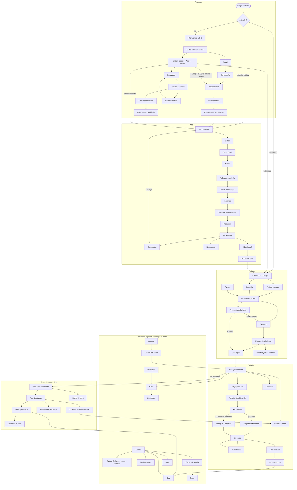

# Fase 4 · Rediseño premium Handyx de la app de especialistas (lotes 4.1–4.9)

Fecha: 29/10/2026 · Pedido de Ignacio: rehacer el diseño para que sea único, se sienta Handyx y esté a la altura de la demo
de la landing (o mejor). Tiene que tener mapa, las pantallas de bienvenida, entrada y registro de una app on demand,
una pantalla de carga nueva, y cabecera solo donde suma.

Ignacio decidió el 29/10/2026 que el rediseño sea la **fase 4** del plan. El backend pasa a la **fase 5** y el deploy a la **6**
(`docs/plan.md`). La fase 5 arranca después del sí de diseño del lote 4.9.

## 1. Diagnóstico: por qué hoy no convence

| Problema | Dónde se ve | Qué cambia |
|---|---|---|
| Parece una web de formularios, no una app | Todas: columnas de tarjetas grises, mucho texto, poca jerarquía visual | Pantallas armadas sobre el mapa, hojas inferiores, títulos grandes que colapsan y montos como protagonistas |
| La cabecera ocupa lugar en todos lados | Logo + campana fijos en cada pantalla, también en detalles y flujos | Cabecera solo en Inicio. Barra compacta en el resto. Pantalla completa en los flujos |
| No hay mapa | Pedidos, cobertura y trabajo muestran la zona en texto | Mapa propio de Mar del Plata con estilo Handyx (§4) |
| Falta la entrada de una app on demand | Hoy se cae directo a un formulario de email | Carga → bienvenida → entrar o crear cuenta → verificación → alta guiada |
| El alta es un formulario de 6 pasos | Inputs apilados y documentos "de prueba" | Lista de pasos con progreso, marco de cámara para DNI y selfie, rubros en mosaico, zonas en el mapa |
| Pocos momentos de emoción | Aceptar, ganar un trabajo y terminar se ven igual que todo lo demás | Isla de avisos, confeti y monto que sube al ganar o terminar un trabajo (como la demo) |
| Faltan pantallas | Contraseña nueva, verificación de email, cobros, contactos, centro de ayuda, notificaciones agrupadas, entre otras | Inventario completo en §6 |

## 2. Dirección de arte: "Handyx, la caja de herramientas viva"

Base: el kit de la demo de la landing (`Handy-landing-page-fe/src/styles/demo-app.css`, clases `.hd-*`) y sus 25 pantallas
`e-*`. De apps como Rappi o PedidosYa se toman **patrones** (inicio sobre el mapa, hojas arrastrables, estado del pedido como
línea de tiempo, botón de acción fijo abajo, avisos que bajan desde arriba). Nunca su marca, sus colores ni sus recursos.

Lo que hace que se sienta Handyx y no otra app:

1. **Azul Handy como protagonista**: bloque azul con esquinas grandes arriba en Inicio, botones cuadrados con base que se
   hunde, títulos en Archivo 900 ensanchado con marcador amarillo `==así==`.
2. **Los Handys actúan**: celebran cuando te eligen, se rompen cuando algo falla, esperan con vos mientras el cliente decide
   y saludan en los estados vacíos. Siempre decorativos: el texto dice lo que pasa.
3. **Mosaicos grises de la app**: rubros, zonas y franjas como mosaicos tocables, igual que en la app real (`assets/fotos`).
4. **El mapa como lienzo**: manzanas en gris claro, avenidas en azul pálido y la costa con olas, como el mapa de la demo pero
   sobre datos reales.
5. **La isla**: los avisos importantes bajan como una píldora oscura desde arriba ("¡El cliente te eligió!", "Cobro
   registrado"), con el ícono y el texto.
6. **La plata grande y honesta**: montos enormes en Archivo con cifras tabulares, con el desglose siempre a mano y "a tu
   cuenta" en verde.

### Reglas de forma (actualizan `docs/diseno.md`)

| Regla | Antes (lote 3.1–3.3) | Ahora |
|---|---|---|
| Cabecera | Logo y campana en todas las pantallas | Solo en Inicio. Pestañas raíz: título grande que colapsa al bajar. Detalles: barra compacta con "atrás". Flujos (auth, alta, propuesta, en camino): pantalla completa, sin pestañas |
| Barra de pestañas | Fija en todas las pantallas de la app | Flotante, solo en las 4 raíz (Inicio, Agenda, Mensajes, Cuenta) |
| Acción principal | Botón en el flujo del contenido | Fija abajo, sobre el área segura, y nunca tapa contenido |
| Celebraciones | Prohibido el confeti y los montos animados | Permitidos **solo** al ganar un trabajo, terminarlo y registrar un cobro. Nunca en decisiones pendientes, vencimientos ni urgencia |
| Movimiento | Máximo 0,6 s | Transiciones entre pantallas (empujar/deslizar), hojas con física y la carga de la app (§3). Todo se apaga con "reducir movimiento" |
| Densidad | Mucho texto de ayuda en cada tarjeta | Un dato por línea, la ayuda en "Ver más" o en una hoja |

Lo que no cambia: tipo ≠ estado, aceptar verde / rechazar en contorno rojo con confirmación, urgencia en texto neutro, WCAG 2.2 AA
(axe en 0), áreas táctiles de 44 px, nada en el almacenamiento del navegador, nunca caer a datos de prueba.

### Técnica

- Se rehace la **capa visual** (`src/components`, `src/pantallas`, `globals.css`) y se **conserva** todo lo demás:
  - El puerto de datos, el mock, el adaptador HTTP, los contratos y los hooks.
  - Las reglas del mock y sus pruebas.
  - El service worker.
- Animación: **GSAP** (misma biblioteca que la landing, gratuita). Las transiciones de pantalla con la View Transitions API
  cuando el navegador la tiene.
- El mapa (MapLibre) se carga solo en las pantallas que lo usan, para no pesar en la primera carga.
- Presupuesto en un Android de gama baja:
  - Primera carga sin mapa: menos de 2,5 s.
  - JS inicial: menos de 220 KB comprimido.
  - Mapa: menos de 250 KB más las teselas de la zona visible.

## 3. Pantalla de carga de la app (nueva, distinta a la de la landing)

La landing tiene un contador hasta 100 con los Handys asomando. La app arranca distinto:

1. **Fondo que cambia de color** al ritmo de los saltos: azul Handy → amarillo → noche → azul.
2. **Los cinco Handys saltan en fila** (gota, caño, engranaje, lamparita, llave). Cada salto tiene un pequeño aplaste al caer y
   una sombra que se achica y se agranda.
3. **Final**: cae el logo "handyx" desde arriba. Los cinco Handys aterrizan debajo, en fila, y **se agarran de las manos todos
   juntos**. Dan un último saltito al mismo tiempo, el logo rebota una vez y la pantalla se abre hacia Inicio, o hacia la
   bienvenida si no hay sesión.
4. Duración: 2,4 s si la app ya está lista; nunca más de 4 s. Se puede saltear tocando.
   - No se repite al navegar dentro de la app: solo en el arranque en frío, con un estado en memoria y sin sessionStorage.
   - Con "reducir movimiento", el logo aparece fijo con los Handys quietos durante 0,6 s.
5. Usa las poses nuevas de los Handys: saltando, cayendo, de la mano a izquierda y a derecha, y celebrando. El prompt para
   generarlas está en `docs/handys-prompt.md`. Mientras no estén, se resuelve con rotación y aplaste de las imágenes actuales.

## 4. Mapa (obligatorio)

### Qué usamos

| Opción | Costo y cuentas | Privacidad | Recomendación |
|---|---|---|---|
| **MapLibre GL + teselas vectoriales propias (PMTiles de OpenStreetMap)** | Gratis. Un archivo con Mar del Plata y Batán servido desde el mismo hosting. Sin cuentas ni claves | La ubicación nunca va a un tercero | **Sí** |
| MapTiler, Stadia u otro proveedor de teselas | Plan gratis con cuenta y clave pública; pago al crecer | El proveedor ve qué zonas se piden | Plan B |
| Google Maps JS | Cuenta con facturación | Google ve todo | No |

- Estilo propio Handyx: manzanas en gris mosaico, avenidas en azul pálido, el mar en el azul de la demo y nombres de barrio
  en DM Sans.
- Atribución de OpenStreetMap visible (licencia ODbL).
- El archivo de teselas se genera una vez con herramientas libres y se versiona fuera del repo. Peso estimado: 15–40 MB, que
  se descarga por partes, solo la zona visible.
- **Geocodificación** (dirección → punto): la hace el backend al crear el pedido (fase 5). La app de especialistas nunca
  geocodifica direcciones.

### Ubicación en tiempo real y trayectos (decisión del 29/10/2026)

**¿Se puede?** Sí, con un límite de las apps web.

| Qué | Cómo | Límite |
|---|---|---|
| Mapa completo de Mar del Plata y Batán | Teselas propias desde el hosting | Ninguno: es solo un archivo estático |
| El cliente ve al especialista en vivo | Durante el viaje, la app del especialista manda su posición cada 5–10 s. El servidor se la pasa solo al cliente de ese trabajo con una conexión en vivo (SSE) | En una PWA, **la ubicación se comparte solo con la app abierta y la pantalla encendida**. iPhone y Android cortan el GPS de una web en segundo plano |
| El especialista ve al cliente | La **dirección exacta** del trabajo (fija) desde que hay acuerdo. No se sigue al cliente en vivo: está en su casa, y seguirlo sería un dato sensible sin necesidad | — |
| Trayecto a la casa del cliente | Handyx dibuja el recorrido por las calles con tiempo y distancia, y se recalcula si te desviás. "Abrir en Google Maps / Waze" queda como atajo | El cálculo de recorridos necesita un **motor de trayectos** (§ costos) |
| Llegada | Geocerca: llegada automática al entrar en el radio con la app abierta. **Botón de respaldo** "Ya llegué" cuando no hay permiso, la señal es imprecisa o no hay señal | La geocerca solo funciona con la app abierta (ver la fila del cliente) |

- **En el mock** (fase 4): trayectos precalculados sobre calles reales de Mar del Plata, con un viaje simulado a lo largo del recorrido
  y estados de señal desde el Panel de prueba.
- **Motor de trayectos real** (fase 5, necesita autorización):
  - Recomendado: servidor propio (OSRM o Valhalla) con datos de OpenStreetMap de la zona, en una instancia chica paga de Render.
  - Alternativa: un servicio con plan gratis y cuenta (por ejemplo, OpenRouteService), con un límite de pedidos diarios.
- **Privacidad**:
  - Solo durante el viaje de un trabajo aceptado y con permiso explicado antes de pedirlo.
  - Se deja de compartir al llegar o al cancelar.
  - Solo lo ven las dos partes de ese trabajo.
  - Retención de 30 días (lote 5.3).

### Dónde aparece el mapa

| Pantalla | Qué muestra | Regla de privacidad |
|---|---|---|
| Inicio | Tu zona de cobertura, pedidos abiertos como **zonas aproximadas** (círculos) y un radar mientras estás disponible | Nunca un punto exacto antes del acuerdo |
| Pedido entrante y detalle | Círculo aproximado del barrio y distancia aproximada | El servidor manda el centro ya desplazado y el radio. La app no recibe la dirección |
| Cobertura y zonas | Barrios para tocar y elegir, y radio desde tu base | Tu base (dirección propia) es dato sensible: solo vos y Operations |
| Trabajo acordado | Dirección exacta del cliente y "Cómo llegar" | Solo para las dos partes y solo en ese trabajo |
| En camino | Tu posición en vivo, el trayecto dibujado, el tiempo estimado y el destino | Opt-in, solo durante el viaje. Se deja de compartir al llegar. Retención de 30 días (lote 5.3) |
| Agenda del día | Los trabajos del día en el mapa (opcional) | Solo trabajos acordados |

## 5. Pasos del re-plan (lotes)

Cada lote termina con capturas en 4 tamaños, `npm run accesibilidad` en 0, E2E actualizado y revisión de Ignacio sobre la página
de flujos (la del artifact) antes del siguiente.

| Lote | Qué | Modelo / esfuerzo |
|---|---|---|
| 4.1 | Marca Handyx, sistema visual v2 y kit de componentes | Opus 5.5 / high |
| 4.2 | Carga, bienvenida, entrada (email, Google, Apple), registro con código y recuperación | Opus 5.5 / high |
| 4.3 | Mapa, ubicación en tiempo real y trayectos | Opus 5.5 / xhigh |
| 4.4 | Alta guiada premium | Opus 5.5 / high |
| 4.5 | Inicio, pedidos y propuesta con precio sugerido | Opus 5.5 / high |
| 4.6 | Trabajo de punta a punta (llegada automática + respaldo, adicionales) | Opus 5.5 / high |
| 4.7 | Obras de varios días | Opus 5.5 / high |
| 4.8 | Agenda, mensajes, cuenta, caja y ayuda | Sonnet 5.5 / high |
| 4.9 | QA premium y sí de diseño | Opus 5.5 / high |

### 4.1 · Marca Handyx, sistema visual v2 y kit

**Estado: cerrado localmente (29/10/2026).** El kit está en `src/kit/` y se ve en `/catalogo/` (solo mock).

- **Marca**: todos los textos visibles pasan de "Handy" a **"Handyx"**:
  - "Tarifa de Handyx", "Handyx sugiere", "Verificado por Handyx" y "Handyx nunca te pide tu contraseña", entre otros.
  - Los personajes siguen llamándose "los Handys".
  - Los identificadores del contrato (`feeHandy`…) no cambian: son de `handyx-client-be`.
- Tokens v2: elevaciones (3 niveles), radios de hoja (32 px), duraciones y curvas de movimiento, zona segura, alturas de
  barra y de pestañas.
- Componentes (portados del kit `.hd-*` de la demo a React):
  - `BarraSuperior` (compacta y colapsable) y `PestanasFlotantes`.
  - `Hoja` arrastrable con alturas fijas (1/3, 2/3, completa).
  - `Isla` (aviso que baja), `BotonFijo`, `Mosaico`, `ChipFranja` y `TiraDias`.
  - `Calendario`, `SelectorHora` (rueda), `PrecioStepper` ("Handyx sugiere · Vos decidís") y `MontoGrande`.
  - `Avatar` con iniciales, `LineaDeTiempo`, `Confeti`, `ContadorMonto` y `EstadoVacio` con Handy.
- Catálogo navegable solo en el mock (`/catalogo/`, fuera del build de producción) con cada componente en sus estados.
- Actualizar `docs/diseno.md` con las reglas de §2.
- **Hecho cuando**: el catálogo está completo en claro, con "reducir movimiento" y al 200 %, y axe da 0.

### 4.2 · Carga, bienvenida y cuenta

**Estado: cerrado localmente (29/10/2026).**
- Las pantallas están en `src/app/(cuenta)/` y `src/pantallas/`.
- El contrato sube a 0.3.0.
- Google y Apple se prueban con cuentas de prueba elegidas de una lista. Los SDK reales y el envío de emails llegan en el lote 5.2,
  con autorización de Ignacio.

Pantallas:
1. Carga animada (§3).
2. Bienvenida en 3 láminas con los Handys:
   - "Vos ponés tu precio".
   - "La plata va directo a vos".
   - "0 % de tarifa hasta el 10/12".
3. Elegir: "Crear cuenta" / "Ya tengo cuenta".
4. Entrar:
   - **Continuar con Google**, en todos los dispositivos.
   - **Continuar con Apple**, solo en iPhone, iPad y Mac (se detecta el sistema; en Android y Windows no aparece).
   - O email y contraseña, con mostrar/ocultar y error genérico.
   - Si la cuenta de Google o Apple es nueva, sigue por las aceptaciones y la cuenta creada. Esas cuentas ya traen el email
     verificado, así que no se pide el código.
5. Crear cuenta en 3 pasos cortos:
   - Email.
   - Contraseña, con medidor de fuerza.
   - Términos y privacidad, sin tildar.
6. **Verificar email con un código de 6 dígitos**:
   - Seis casillas con pegado automático y el teclado numérico.
   - Reenvío habilitado después de 60 s.
   - Intentos limitados.
   - "Cambiar el email".
7. Cuenta creada, con fee 0 % y celebración.
8. Recuperar (email) → Revisá tu correo → **Contraseña nueva** → **Listo**, más **enlace vencido**.
9. Sesión expirada.
10. Volver a entrar ("Hola de nuevo").

Sin entrada por teléfono ni SMS. En el mock, Google y Apple se simulan con un botón "Cuenta de prueba"; el ingreso real va en la fase 5.
**Hecho cuando**: hay E2E con capturas de registro con código, entrada con email, Google y Apple simulados, y recuperación.

### 4.3 · Mapa, ubicación en tiempo real y trayectos

**Estado (29/10/2026): hecho localmente, menos el mapa base.** Detalle en `docs/mapa.md`.
- Listo: el componente, el contrato 0.4.0, el mock con el GPS simulado y las pantallas (zona del pedido, cómo llegar, En
  camino), además de E2E M1–M3 y accesibilidad.
- Bloqueado: la red del entorno no deja bajar los datos de OpenStreetMap (`overpass-api.de`). Ignacio lo va a habilitar. Con
  eso, `npm run mapa:descargar && npm run mapa:generar` arma las teselas, los barrios y el grafo, y hay que volver a medir el
  rendimiento.
- Cambio respecto del plan: teselas en carpetas `{z}/{x}/{y}.pbf` en lugar de PMTiles (sin depender de pedidos por rangos del
  hosting).

- MapLibre con estilo Handyx y teselas de prueba de Mar del Plata servidas por el servidor local de E2E.
- Componente `Mapa` con capas para cobertura, zona aproximada, pin del trabajo, mi posición y radar.
- Carga diferida.
- Si el mapa no carga: mosaico con el barrio en texto. Nunca una pantalla rota.
- Pedido de ubicación con explicación previa (solo durante el viaje, como la demo).
- **Ubicación en vivo**, simulada en el mock: el punto del especialista avanza por el trayecto, con estados de señal (normal,
  imprecisa, sin señal, sin permiso) que se cambian desde el Panel de prueba.
- **Trayectos**:
  - Líneas por calles reales de Mar del Plata, precalculadas para el mock.
  - Tiempo y distancia estimados.
  - Desvío con recálculo simulado.
  - Atajo a Google Maps o Waze.
- Datos de barrios para la cobertura: fuente a confirmar (datos abiertos del municipio u OpenStreetMap).
- **Hecho cuando**: el mapa anda a 60 fps en un Android de gama media emulado, sin fallas con la red cortada y con la atribución visible.

### 4.4 · Alta guiada

**Estado: cerrado localmente (29/10/2026).**
- Las pantallas están en `src/pantallas/alta/` y viven en el grupo de rutas `(flujo)`, a pantalla completa.
- El contrato sube a 0.5.0.
- La cámara es real con la API y simulada en la vista previa.
- Se arregló la contradicción del resumen en corrección: el escenario no recalculaba lo que faltaba.
- "¡Estás habilitado!" quedó como "¡Tu alta está habilitada!": dice lo mismo sin asumir el género de la persona.

1. **Inicio del alta**: lista de pasos con anillo de progreso, al estilo "Completá tu perfil" de las apps de reparto.
2. **Datos personales**: un dato por pantalla en el celular, con el teclado correcto en cada campo.
3. **Identidad**:
   - DNI con marco de cámara (frente y dorso). En el mock, "documento de prueba".
   - CUIT/CUIL.
4. **Selfie**: marco ovalado y consejos de luz.
5. **Rubros**: mosaico de los 6 rubros; Gas y aire acondicionado piden matrícula.
6. **Zonas** (en el mapa) y **horarios** (franjas en mosaico).
7. **Antecedentes**: elegir turno para la verificación presencial, sin archivos.
8. **Resumen**: cada ítem con su estado y "Corregir", que lleva al paso.
9. **En revisión**: línea de tiempo con un Handy esperando.
10. **Corrección**: lista de lo marcado con acceso directo a cada paso. Se arregla la contradicción del resumen y el botón
    queda deshabilitado hasta resolverla.
11. **Rechazada**.
12. **¡Estás habilitado!**: celebración, luego el modal del fee 0 %, luego "Activá tu disponibilidad".

### 4.5 · Inicio, pedidos y propuesta

**Estado: hecho (29/10/2026).** Las fotos del pedido quedan para cuando el contrato las tenga (hoy `PedidoElegible` no
trae fotos): el detalle y el pedido entrante muestran la zona, la descripción y la fecha pedida.

1. **Inicio sobre el mapa**:
   - Bloque azul con saludo e interruptor grande "Disponible" (urgentes Ahora).
   - Hoja con "Pedidos para vos" y "Tu próximo trabajo".
   - Cobrado del mes.
2. **Pedido entrante** (urgente): hoja sobre el mapa con rubro, zona aproximada, descripción y fotos, vigencia en texto
   neutro, "Ver y cotizar" y "Ahora no". Nunca acepta solo.
3. **Detalle del pedido**: mapa de la zona, fotos y fecha pedida.
4. **Tu precio**:
   - Elegir cuándo podés ir (chips de franjas o "Elegir fecha/horario").
   - Stepper de precio "Handyx sugiere $ X · Vos decidís", con atajos de +$ 1.000 / 2.000 / 5.000.
   - Qué incluye.
   - "Recibís" con fee 0 %.
5. **Esperando al cliente**: un Handy que espera; tu propuesta con su vencimiento.
6. **¡El cliente te eligió!**: isla y confeti, y la pantalla abre el trabajo.
   - Arregla el hallazgo: hoy no hay aviso cuando el usuario acepta.
7. **No te eligieron / venció**: en gris, sin culpa.
8. **Propuesta del cliente**: aceptar, contraofertar o rechazar, con confirmación.
9. **Bandeja**: filtros en chips que entran en 390 px, y orden por llegada o por cercanía.
10. **Avisos**: agrupados en Nuevas / Antes, deslizar para borrar y "Borrar todas".

### 4.6 · Trabajo de punta a punta

**Estado: hecho (29/10/2026).** Supuestos del lote:
- Sin compartir la ubicación, "Ya llegué" también está disponible: sin ubicación no hay geocerca.
- La llamada por la app está en el contrato y simulada en el mock. El proveedor real se paga y se autoriza en la fase 5;
  hasta entonces la llamada no conecta y queda el chat.
- Los adicionales que el cliente no respondió se retiran al terminar, y la confirmación avisa.
- La geocerca es de 80 m con precisión de 50 m o mejor. Son valores provisorios, para ajustar con pruebas en la calle.

1. **Trabajo acordado**: cliente, dirección exacta, mapa, "Cómo llegar", chat y llamada a través de la app (sin mostrar teléfonos).
2. **Salgo para allá**.
3. **En camino**: mapa con mi posición y el destino, y estados de la señal: normal, imprecisa, sin señal, sin permiso.
4. **Llegada**:
   - Automática al entrar en el radio con la app abierta, con aviso al cliente.
   - **Botón de respaldo "Ya llegué"** solo cuando la ubicación anda mal: sin permiso, imprecisa o sin señal.
5. **En curso**: cronómetro y **"Agregar repuestos o mano de obra"** (adicionales):
   - Lista de opciones, con "Opción personalizada" primero.
   - El cliente acepta o rechaza.
   - Mientras tanto, rige el precio vigente.
6. **Terminar** (con confirmación) y **¡Terminaste el trabajo!**: monto que sube, desglose y confeti.
7. **Informar el cobro**.
8. **Cambiar la fecha**: motivo en chips, tira de días y franja; queda como solicitud pendiente.
9. **Cancelar**, con alternativas.
10. **Reclamo**.
11. **Obra de varios días**: ver el lote 4.7.

### 4.7 · Obras de varios días

**Estado: hecho (29/10/2026).** Supuestos del lote:
- Las etapas van de a una: al terminar una, arranca la siguiente.
- Una jornada queda "hecha" cuando se carga su avance en el diario.
- El primer día de la obra pasa por Salgo para allá, la llegada y Empezar; los días siguientes la obra sigue en curso.
- Una obra se cierra desde el plan, con todas las etapas terminadas, y cerrarla no crea otro cobro.
- Las fotos del diario son del trabajo: la app pide que no se vean personas, documentos ni cosas personales del cliente.

Una obra (pintura, revoque, instalación grande) dura días o semanas y hoy se ve como un trabajo más con etapas en una lista.

1. **Resumen de la obra**:
   - Anillo de avance (etapas hechas de las totales).
   - Próxima jornada.
   - Monto acordado, cobrado y pendiente.
   - Accesos a jornadas, etapas, fotos y adicionales.
2. **Plan de obra**: etapas en una línea de tiempo (Preparación → Revoque → Pintura → Terminación). Cada una tiene:
   - Fechas y estado.
   - Su importe.
   - Lo que incluye.
3. **Jornadas en el calendario**:
   - Los días de trabajo marcados en la agenda, como una franja de varios días.
   - Cambiar una jornada es una solicitud y no mueve el resto.
4. **Diario de obra**: avance del día con fotos y una nota corta. El cliente lo ve.
5. **Adicionales por etapa**: los aprueba el cliente, como en un trabajo de un día.
6. **Cobro por etapa**:
   - Al terminar una etapa, se informa su cobro.
   - Reportado ≠ verificado, como en Caja.
7. **Cierre de la obra**: resumen final con todas las etapas, los adicionales y los cobros.

**Hecho cuando**: hay un E2E de una obra de 3 etapas en 5 jornadas, con un cambio de jornada, un adicional y el cobro de cada etapa.

### 4.8 · Agenda, mensajes, cuenta, caja y ayuda

1. **Agenda**: mes con marcas, lista del día y detalle del turno, igual que la demo.
2. **Mensajes**: lista con avatares de iniciales y estado del pedido.
3. **Chat**:
   - Respuestas rápidas ("Salgo para allá", "¿Qué timbre?", "Llave de paso").
   - Propuestas dentro del hilo y fotos.
   - "Programar turno".
4. **Contactos**: solo los agregados desde un chat.
5. **Cuenta**:
   - Perfil con iniciales y la insignia de verificado, solo si lo dice el servidor.
   - Datos personales, rubros y zonas.
   - Cobros: cómo te paga el cliente, Mercado Pago o efectivo.
   - Notificaciones y su configuración.
   - Centro de ayuda.
   - Contador del fee.
   - Privacidad y baja.
6. **Caja**: resumen del mes, filtros por estado y movimientos con su desglose.
7. **Centro de ayuda**: temas en pastillas, casos y detalle del caso.

### 4.9 · QA premium y sí de diseño

- E2E reescritos para los nuevos flujos (más de 15 recorridos) y la página de flujos con capturas actualizada.
- axe en 0 en 4 tamaños, foco y lector de pantalla revisados a mano con VoiceOver en Safari y TalkBack en Chrome (emulado), y
  "reducir movimiento".
- Rendimiento medido con Lighthouse móvil (≥ 90 en rendimiento y accesibilidad).
- Revisión final con Ignacio, que da el **sí de diseño** para empezar la fase 5 (backend).

## 6. Inventario de pantallas (73)

| Grupo | Pantallas | Lote |
|---|---|---|
| Arranque y cuenta (17) | Carga animada · Bienvenida 1/2/3 · Elegir crear o entrar · Entrar (Google, Apple según el dispositivo, email) · Crear cuenta: email / contraseña / aceptaciones · Verificar email (código) · Cuenta creada · Recuperar · Revisá tu correo · Contraseña nueva · Contraseña cambiada · Enlace vencido · Sesión expirada · Hola de nuevo | 4.2 (13 nuevas) |
| Mapa (transversal) | Capas de cobertura, zona aproximada, trayecto, posición en vivo y radar · Permiso de ubicación · Mapa sin conexión | 4.3 |
| Alta (14) | Inicio del alta · Datos · Identidad (DNI frente/dorso, CUIT) · Selfie · Rubros · Matrícula · Zonas en el mapa · Horarios · Turno de antecedentes · Resumen · En revisión · Corrección · Rechazada · ¡Habilitado! | 4.4 (6 nuevas) |
| Inicio y pedidos (12) | Inicio sobre el mapa · Modal fee · Pedido entrante · Bandeja · Detalle del pedido · Tu precio (Handyx sugiere) · Elegir fecha · Elegir horario · Esperando al cliente · ¡Te eligió! · Propuesta del cliente · Avisos | 4.5 (6 nuevas) |
| Trabajo (12) | Trabajo acordado · En camino (trayecto en vivo) · Permiso de ubicación · Llegada automática · Ya llegué (respaldo) · En curso · Adicionales · Terminar · ¡Terminaste! · Informar cobro · Cambiar fecha · Cancelar | 4.6 (7 nuevas) |
| Obras de varios días (7) | Resumen de la obra · Plan de etapas · Jornadas en el calendario · Diario de obra · Adicionales por etapa · Cobro por etapa · Cierre de la obra | 4.7 (6 nuevas) |
| Agenda, chat y cuenta (12) | Agenda · Detalle del turno · Mensajes · Chat · Contactos · Cuenta · Datos personales · Rubros y zonas · Cobros · Notificaciones y configuración · Caja · Centro de ayuda y caso | 4.8 (5 nuevas) |
| Transversales | Sin conexión · Error con Handy roto · 404 · Baja · Catálogo (solo mock) | 4.1–4.8 |

## 7. Cambios de contrato a proponer a `handyx-client-be` (v0.3.0)

Se piden antes de la fase 5. En el mock se emulan desde el lote donde aparecen.

| Cambio | Para qué | Lote |
|---|---|---|
| Verificación de email: enviar y confirmar un código de 6 dígitos, con vencimiento e intentos | Crear cuenta | 4.2 |
| Entrar con Google y con Apple (OpenID Connect) y vincular cuentas | Entrar | 4.2 |
| Restablecer la contraseña con un token y el estado del token | Contraseña nueva y enlace vencido | 4.2 |
| Zona aproximada del pedido: centro desplazado por el servidor y radio en metros | Mapa sin dirección exacta | 4.3 |
| Posiciones del viaje (enviar y seguir en vivo con SSE), trayecto, tiempo estimado y estado de la señal | Ubicación en tiempo real | 4.3 / 4.6 |
| Cobertura por barrios (ids) y radio desde la base | Zonas en el mapa | 4.3 / 4.4 |
| Turnos de verificación presencial de antecedentes | Elegir turno sin archivos | 4.4 |
| Precio sugerido por rubro y tipo, con su fuente y versión | "Handyx sugiere" | 4.5 |
| Aviso "propuesta aceptada" con el id del trabajo | ¡Te eligió! | 4.5 |
| Llegada: automática (geocerca) o de respaldo, con el motivo | Llegada | 4.6 |
| Adicionales: crear, y que el cliente acepte o rechace | Repuestos y mano de obra | 4.6 / 4.7 |
| Obras: etapas, jornadas, diario con fotos y cobro por etapa | Obras de varios días | 4.7 |

## 8. Decisiones de Ignacio (29/10/2026)

| # | Tema | Decisión |
|---|---|---|
| 1 | Llegada | Automática por geocerca con la app abierta; botón de respaldo "Ya llegué" solo si la ubicación anda mal |
| 2 | Mapa | Mapa completo propio de Mar del Plata y Batán. El cliente ve al especialista en vivo durante el viaje, y Handyx dibuja el trayecto hasta la casa del cliente (§4) |
| 3 | Verificar el email | Código de 6 dígitos al email |
| 4 | Google y Apple | Los dos. Google en todos los dispositivos; Apple solo en dispositivos Apple |
| 5 | Adicionales | Se incluyen, y las obras de varios días tienen su propio lote (4.7) |
| 6 | Precio | "Handyx sugiere · Vos decidís", y todos los textos de la marca pasan a "Handyx" |
| 7 | Cupones y camada fundadora | No se muestran mientras el fee sea 0 % |
| 8 | Pantalla de carga | Los Handys terminan todos juntos de la mano con el logo |
| 9 | Imágenes de los Handys | Poses nuevas, una por personaje, sobre fondo verde (`docs/handys-prompt.md`) |

**Cuentas y costos que hay que autorizar antes de la fase 5** (en la fase 4 todo es mock y no cuesta nada):

| Qué | Para qué | Costo |
|---|---|---|
| Apple Developer Program | Entrar con Apple | ≈ USD 99 al año |
| Proyecto de Google Cloud (OAuth) | Entrar con Google | Gratis |
| Proveedor de emails transaccionales | Códigos de 6 dígitos y recuperación | Plan gratis con cuenta. Pago según el volumen |
| Motor de trayectos (OSRM o Valhalla propio, o un servicio con plan gratis) | Trayectos y tiempo estimado | Una instancia chica paga en Render, o gratis con límite diario |
| Teselas del mapa | Mapa | Sin costo extra (Hostinger) |
| Proveedor de telefonía con números puente (agregado en el 4.6) | Llamar por la app sin mostrar teléfonos | Pago por minuto y por número; hay que cotizarlo. Hasta tenerlo, queda el chat |

## 9. Mapa de pantallas

Líneas punteadas: caminos alternativos (respaldo o según el dispositivo).

