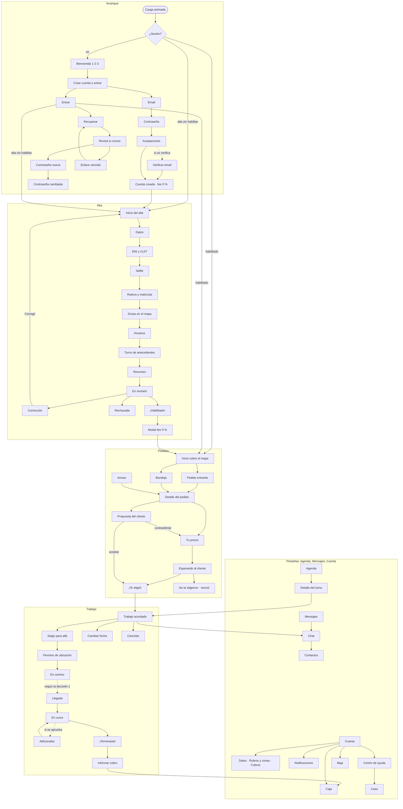

# Re-plan · Rediseño premium de la app de especialistas (fase 3, lotes 3.4–3.11)

Fecha: 29/10/2026 · Pedido de Ignacio: rehacer el diseño para que sea único, se sienta Handyx y esté a la altura de la demo
de la landing (o mejor). Tiene que tener mapa, las pantallas de bienvenida, entrada y registro de una app on demand,
una pantalla de carga nueva, y cabecera solo donde suma.

Es una **reapertura de la fase 3**, no una fase nueva (el plan tiene 5 fases). La fase 4 (backend) arranca después del lote 3.11.

## 1. Diagnóstico: por qué hoy no convence

| Problema | Dónde se ve | Qué cambia |
|---|---|---|
| Parece una web de formularios, no una app | Todas: columnas de tarjetas grises, mucho texto, poca jerarquía visual | Pantallas armadas sobre el mapa, hojas inferiores, títulos grandes que colapsan y montos como protagonistas |
| La cabecera ocupa lugar en todos lados | Logo + campana fijos en cada pantalla, también en detalles y flujos | Cabecera solo en Inicio. Barra compacta en el resto. Pantalla completa en los flujos |
| No hay mapa | Pedidos, cobertura y trabajo muestran la zona en texto | Mapa propio de Mar del Plata con estilo Handyx (§4) |
| Falta la entrada de una app on demand | Hoy se cae directo a un formulario de email | Carga → bienvenida → entrar o crear cuenta → verificación → alta guiada |
| El alta es un formulario de 6 pasos | Inputs apilados y documentos "de prueba" | Lista de pasos con progreso, marco de cámara para DNI y selfie, rubros en mosaico, zonas en el mapa |
| Pocos momentos de emoción | Aceptar, ganar un trabajo y terminar se ven igual que todo lo demás | Isla de avisos, confeti y monto que sube al ganar o terminar un trabajo (como la demo) |
| Faltan pantallas | Contraseña nueva, verificación de email, cobros, contactos, centro de ayuda, notificaciones agrupadas, entre otras | Inventario completo en §6 |

## 2. Dirección de arte: "Handyx, la caja de herramientas viva"

Base: el kit de la demo de la landing (`Handy-landing-page-fe/src/styles/demo-app.css`, clases `.hd-*`) y sus 25 pantallas
`e-*`. De apps como Rappi o PedidosYa se toman **patrones** (inicio sobre el mapa, hojas arrastrables, estado del pedido como
línea de tiempo, botón de acción fijo abajo, avisos que bajan desde arriba). Nunca su marca, sus colores ni sus recursos.

Lo que hace que se sienta Handyx y no otra app:

1. **Azul Handy como protagonista**: bloque azul con esquinas grandes arriba en Inicio, botones cuadrados con base que se
   hunde, títulos en Archivo 900 ensanchado con marcador amarillo `==así==`.
2. **Los Handys actúan**: celebran cuando te eligen, se rompen cuando algo falla, esperan con vos mientras el cliente decide
   y saludan en los estados vacíos. Siempre decorativos: el texto dice lo que pasa.
3. **Mosaicos grises de la app**: rubros, zonas y franjas como mosaicos tocables, igual que en la app real (`assets/fotos`).
4. **El mapa como lienzo**: manzanas en gris claro, avenidas en azul pálido y la costa con olas, como el mapa de la demo pero
   sobre datos reales.
5. **La isla**: los avisos importantes bajan como una píldora oscura desde arriba ("¡El cliente te eligió!", "Cobro
   registrado"), con el ícono y el texto.
6. **La plata grande y honesta**: montos enormes en Archivo con cifras tabulares, con el desglose siempre a mano y "a tu
   cuenta" en verde.

### Reglas de forma (actualizan `docs/diseno.md`)

| Regla | Antes (lote 3.1–3.3) | Ahora |
|---|---|---|
| Cabecera | Logo y campana en todas las pantallas | Solo en Inicio. Pestañas raíz: título grande que colapsa al bajar. Detalles: barra compacta con "atrás". Flujos (auth, alta, propuesta, en camino): pantalla completa, sin pestañas |
| Barra de pestañas | Fija en todas las pantallas de la app | Flotante, solo en las 4 raíz (Inicio, Agenda, Mensajes, Cuenta) |
| Acción principal | Botón en el flujo del contenido | Fija abajo, sobre el área segura, y nunca tapa contenido |
| Celebraciones | Prohibido el confeti y los montos animados | Permitidos **solo** al ganar un trabajo, terminarlo y registrar un cobro. Nunca en decisiones pendientes, vencimientos ni urgencia |
| Movimiento | Máximo 0,6 s | Transiciones entre pantallas (empujar/deslizar), hojas con física y la carga de la app (§3). Todo se apaga con "reducir movimiento" |
| Densidad | Mucho texto de ayuda en cada tarjeta | Un dato por línea, la ayuda en "Ver más" o en una hoja |

Lo que no cambia: tipo ≠ estado, aceptar verde / rechazar en contorno rojo con confirmación, urgencia en texto neutro, WCAG 2.2 AA
(axe en 0), áreas táctiles de 44 px, nada en el almacenamiento del navegador, nunca caer a datos de prueba.

### Técnica

- Se rehace la **capa visual** (`src/components`, `src/pantallas`, `globals.css`) y se **conserva** todo lo demás:
  - El puerto de datos, el mock, el adaptador HTTP, los contratos y los hooks.
  - Las reglas del mock y sus pruebas.
  - El service worker.
- Animación: **GSAP** (misma biblioteca que la landing, gratuita). Las transiciones de pantalla con la View Transitions API
  cuando el navegador la tiene.
- El mapa (MapLibre) se carga solo en las pantallas que lo usan, para no pesar en la primera carga.
- Presupuesto en un Android de gama baja:
  - Primera carga sin mapa: menos de 2,5 s.
  - JS inicial: menos de 220 KB comprimido.
  - Mapa: menos de 250 KB más las teselas de la zona visible.

## 3. Pantalla de carga de la app (nueva, distinta a la de la landing)

La landing tiene un contador hasta 100 con los Handys asomando. La app arranca distinto:

1. **Fondo que cambia de color** al ritmo de los saltos: azul Handy → amarillo → noche → azul.
2. **Los cinco Handys saltan en fila** (gota, caño, engranaje, lamparita, llave). Cada salto tiene un pequeño aplaste al caer y
   una sombra que se achica y se agranda.
3. **Final**: cae el logo "handyx" desde arriba y los Handys se agarran de las letras. La llave se engancha en la "x", la
   lamparita se cuelga de la "h" y el resto queda sentado sobre la palabra. El logo rebota una vez y la pantalla se abre
   hacia Inicio, o hacia la bienvenida si no hay sesión.
4. Duración: 2,4 s si la app ya está lista; nunca más de 4 s. Se puede saltear tocando.
   - No se repite al navegar dentro de la app: solo en el arranque en frío, con un estado en memoria y sin sessionStorage.
   - Con "reducir movimiento", el logo aparece fijo con los Handys quietos durante 0,6 s.
5. Se arma con las imágenes que ya existen en `public/handys/` y el logo. Si hacen falta Handys en pose de salto o colgados,
   se piden a diseño. Mientras tanto se resuelve con rotación y aplaste de las imágenes actuales.

**Supuesto a confirmar**: interpreté "al final agarramos de las o con el logo" como "los Handys terminan agarrados del logo
handyx". Si la idea era otra (por ejemplo, que formen la "o" de algo), se ajusta en el lote 3.5.

## 4. Mapa (obligatorio)

### Qué usamos

| Opción | Costo y cuentas | Privacidad | Recomendación |
|---|---|---|---|
| **MapLibre GL + teselas vectoriales propias (PMTiles de OpenStreetMap)** | Gratis. Un archivo con Mar del Plata y Batán servido desde el mismo hosting. Sin cuentas ni claves | La ubicación nunca va a un tercero | **Sí** |
| MapTiler, Stadia u otro proveedor de teselas | Plan gratis con cuenta y clave pública; pago al crecer | El proveedor ve qué zonas se piden | Plan B |
| Google Maps JS | Cuenta con facturación | Google ve todo | No |

- Estilo propio Handyx: manzanas en gris mosaico, avenidas en azul pálido, el mar en el azul de la demo y nombres de barrio
  en DM Sans.
- Atribución de OpenStreetMap visible (licencia ODbL).
- El archivo de teselas se genera una vez con herramientas libres y se versiona fuera del repo. Peso estimado: 15–40 MB, que
  se descarga por partes, solo la zona visible.
- **Cómo llegar**: botón "Abrir en Google Maps / Waze" que abre la app de navegación del teléfono (lo toca la persona). Sin
  motor de rutas propio en la demo.
- **Geocodificación** (dirección → punto): la hace el backend al crear el pedido (fase 4). La app de especialistas nunca
  geocodifica direcciones.

### Dónde aparece el mapa

| Pantalla | Qué muestra | Regla de privacidad |
|---|---|---|
| Inicio | Tu zona de cobertura, pedidos abiertos como **zonas aproximadas** (círculos) y un radar mientras estás disponible | Nunca un punto exacto antes del acuerdo |
| Pedido entrante y detalle | Círculo aproximado del barrio y distancia aproximada | El servidor manda el centro ya desplazado y el radio. La app no recibe la dirección |
| Cobertura y zonas | Barrios para tocar y elegir, y radio desde tu base | Tu base (dirección propia) es dato sensible: solo vos y Operations |
| Trabajo acordado | Dirección exacta del cliente y "Cómo llegar" | Solo para las dos partes y solo en ese trabajo |
| En camino | Tu posición (si la compartís) y el destino | Opt-in, solo durante el viaje. Se deja de compartir al llegar. Retención de 30 días (lote 4.2) |
| Agenda del día | Los trabajos del día en el mapa (opcional) | Solo trabajos acordados |

## 5. Pasos del re-plan (lotes)

Cada lote termina con capturas en 4 tamaños, `npm run accesibilidad` en 0, E2E actualizado y revisión de Ignacio sobre la página
de flujos (la del artifact) antes del siguiente.

| Lote | Qué | Modelo / esfuerzo |
|---|---|---|
| 3.4 | Sistema visual v2 y kit de componentes | Opus 5.5 / high |
| 3.5 | Carga, bienvenida, entrada, registro y recuperación | Opus 5.5 / high |
| 3.6 | Mapa | Opus 5.5 / high |
| 3.7 | Alta guiada premium | Opus 5.5 / high |
| 3.8 | Inicio, pedidos y propuesta | Opus 5.5 / high |
| 3.9 | Trabajo de punta a punta | Opus 5.5 / high |
| 3.10 | Agenda, mensajes, cuenta, caja y ayuda | Sonnet 5.5 / high |
| 3.11 | QA premium y cierre de diseño | Opus 5.5 / high |

### 3.4 · Sistema visual v2 y kit

- Tokens v2: elevaciones (3 niveles), radios de hoja (32 px), duraciones y curvas de movimiento, zona segura, alturas de
  barra y de pestañas.
- Componentes (portados del kit `.hd-*` de la demo a React):
  - `BarraSuperior` (compacta y colapsable) y `PestanasFlotantes`.
  - `Hoja` arrastrable con alturas fijas (1/3, 2/3, completa).
  - `Isla` (aviso que baja), `BotonFijo`, `Mosaico`, `ChipFranja` y `TiraDias`.
  - `Calendario`, `SelectorHora` (rueda), `PrecioStepper` ("Handy sugiere · Vos decidís") y `MontoGrande`.
  - `Avatar` con iniciales, `LineaDeTiempo`, `Confeti`, `ContadorMonto` y `EstadoVacio` con Handy.
- Catálogo navegable solo en el mock (`/catalogo/`, fuera del build de producción) con cada componente en sus estados.
- Actualizar `docs/diseno.md` con las reglas de §2.
- **Hecho cuando**: el catálogo está completo en claro, con "reducir movimiento" y al 200 %, y axe da 0.

### 3.5 · Carga, bienvenida y cuenta

Pantallas:
1. Carga animada (§3).
2. Bienvenida en 3 láminas con los Handys:
   - "Vos ponés tu precio".
   - "La plata va directo a vos".
   - "0 % de tarifa hasta el 10/12".
3. Elegir: "Crear cuenta" / "Ya tengo cuenta".
4. Entrar: email, contraseña con mostrar/ocultar y error genérico.
5. Crear cuenta en 3 pasos cortos:
   - Email.
   - Contraseña, con medidor de fuerza.
   - Términos y privacidad, sin tildar.
6. **Verificar email** (código de 6 dígitos, si se aprueba en §8).
7. Cuenta creada, con fee 0 % y celebración.
8. Recuperar (email) → Revisá tu correo → **Contraseña nueva** → **Listo**, más **enlace vencido**.
9. Sesión expirada.
10. Volver a entrar ("Hola de nuevo").

Sin entrada con Google, Apple ni teléfono por ahora (§8). **Hecho cuando**: E2E de registro, verificación, entrada y
recuperación, con capturas.

### 3.6 · Mapa

- MapLibre con estilo Handyx y teselas de prueba de Mar del Plata servidas por el servidor local de E2E.
- Componente `Mapa` con capas para cobertura, zona aproximada, pin del trabajo, mi posición y radar.
- Carga diferida.
- Si el mapa no carga: mosaico con el barrio en texto. Nunca una pantalla rota.
- Pedido de ubicación con explicación previa (solo durante el viaje, como la demo).
- Datos de barrios para la cobertura: fuente a confirmar (datos abiertos del municipio u OpenStreetMap).
- **Hecho cuando**: el mapa anda a 60 fps en un Android de gama media emulado, sin fallas con la red cortada y con la atribución visible.

### 3.7 · Alta guiada

1. **Inicio del alta**: lista de pasos con anillo de progreso, al estilo "Completá tu perfil" de las apps de reparto.
2. **Datos personales**: un dato por pantalla en el celular, con el teclado correcto en cada campo.
3. **Identidad**:
   - DNI con marco de cámara (frente y dorso). En el mock, "documento de prueba".
   - CUIT/CUIL.
4. **Selfie**: marco ovalado y consejos de luz.
5. **Rubros**: mosaico de los 6 rubros; Gas y aire acondicionado piden matrícula.
6. **Zonas** (en el mapa) y **horarios** (franjas en mosaico).
7. **Antecedentes**: elegir turno para la verificación presencial, sin archivos.
8. **Resumen**: cada ítem con su estado y "Corregir", que lleva al paso.
9. **En revisión**: línea de tiempo con un Handy esperando.
10. **Corrección**: lista de lo marcado con acceso directo a cada paso. Se arregla la contradicción del resumen y el botón
    queda deshabilitado hasta resolverla.
11. **Rechazada**.
12. **¡Estás habilitado!**: celebración, luego el modal del fee 0 %, luego "Activá tu disponibilidad".

### 3.8 · Inicio, pedidos y propuesta

1. **Inicio sobre el mapa**:
   - Bloque azul con saludo e interruptor grande "Disponible" (urgentes Ahora).
   - Hoja con "Pedidos para vos" y "Tu próximo trabajo".
   - Cobrado del mes.
2. **Pedido entrante** (urgente): hoja sobre el mapa con rubro, zona aproximada, descripción y fotos, vigencia en texto
   neutro, "Ver y cotizar" y "Ahora no". Nunca acepta solo.
3. **Detalle del pedido**: mapa de la zona, fotos y fecha pedida.
4. **Tu precio**:
   - Elegir cuándo podés ir (chips de franjas o "Elegir fecha/horario").
   - Stepper de precio "Handy sugiere $ X · Vos decidís", con atajos de +$ 1.000 / 2.000 / 5.000.
   - Qué incluye.
   - "Recibís" con fee 0 %.
5. **Esperando al cliente**: un Handy que espera; tu propuesta con su vencimiento.
6. **¡El cliente te eligió!**: isla y confeti, y la pantalla abre el trabajo.
   - Arregla el hallazgo: hoy no hay aviso cuando el usuario acepta.
7. **No te eligieron / venció**: en gris, sin culpa.
8. **Propuesta del cliente**: aceptar, contraofertar o rechazar, con confirmación.
9. **Bandeja**: filtros en chips que entran en 390 px, y orden por llegada o por cercanía.
10. **Avisos**: agrupados en Nuevas / Antes, deslizar para borrar y "Borrar todas".

### 3.9 · Trabajo de punta a punta

1. **Trabajo acordado**: cliente, dirección exacta, mapa, "Cómo llegar", chat y llamada a través de la app (sin mostrar teléfonos).
2. **Salgo para allá**.
3. **En camino**: mapa con mi posición y el destino, y estados de la señal: normal, imprecisa, sin señal, sin permiso.
4. **Llegada**, según la decisión de §8.
5. **En curso**: cronómetro y "Agregar repuestos o mano de obra" (adicionales, si se aprueban en §8).
6. **Terminar** (con confirmación) y **¡Terminaste el trabajo!**: monto que sube, desglose y confeti.
7. **Informar el cobro**.
8. **Cambiar la fecha**: motivo en chips, tira de días y franja; queda como solicitud pendiente.
9. **Cancelar**, con alternativas.
10. **Reclamo**.
11. **Obra por etapas**.

### 3.10 · Agenda, mensajes, cuenta, caja y ayuda

1. **Agenda**: mes con marcas, lista del día y detalle del turno, igual que la demo.
2. **Mensajes**: lista con avatares de iniciales y estado del pedido.
3. **Chat**:
   - Respuestas rápidas ("Salgo para allá", "¿Qué timbre?", "Llave de paso").
   - Propuestas dentro del hilo y fotos.
   - "Programar turno".
4. **Contactos**: solo los agregados desde un chat.
5. **Cuenta**:
   - Perfil con iniciales y la insignia de verificado, solo si lo dice el servidor.
   - Datos personales, rubros y zonas.
   - Cobros: cómo te paga el cliente, Mercado Pago o efectivo.
   - Notificaciones y su configuración.
   - Centro de ayuda.
   - Contador del fee.
   - Privacidad y baja.
6. **Caja**: resumen del mes, filtros por estado y movimientos con su desglose.
7. **Centro de ayuda**: temas en pastillas, casos y detalle del caso.

### 3.11 · QA premium y cierre

- E2E reescritos para los nuevos flujos (más de 15 recorridos) y la página de flujos con capturas actualizada.
- axe en 0 en 4 tamaños, foco y lector de pantalla revisados a mano con VoiceOver en Safari y TalkBack en Chrome (emulado), y
  "reducir movimiento".
- Rendimiento medido con Lighthouse móvil (≥ 90 en rendimiento y accesibilidad).
- Revisión final con Ignacio, que da el **sí de diseño** para empezar la fase 4.

## 6. Inventario de pantallas (65)

**Nueva**: no existe hoy. **Rehacer**: existe y se rediseña.

| Grupo | Pantallas | Lote |
|---|---|---|
| Arranque y cuenta (16) | Carga animada · Bienvenida 1/2/3 · Elegir crear o entrar · Entrar · Crear cuenta: email / contraseña / aceptaciones · Verificar email · Cuenta creada · Recuperar · Revisá tu correo · Contraseña nueva · Contraseña cambiada · Enlace vencido · Sesión expirada | 3.5 (12 nuevas) |
| Alta (14) | Inicio del alta · Datos · Identidad (DNI frente/dorso, CUIT) · Selfie · Rubros · Matrícula · Zonas en el mapa · Horarios · Turno de antecedentes · Resumen · En revisión · Corrección · Rechazada · ¡Habilitado! | 3.7 (6 nuevas) |
| Inicio y pedidos (12) | Inicio sobre el mapa · Modal fee · Pedido entrante · Bandeja · Detalle del pedido · Tu precio · Elegir fecha · Elegir horario · Esperando al cliente · ¡Te eligió! · Propuesta del cliente · Avisos | 3.8 (6 nuevas) |
| Trabajo (11) | Trabajo acordado · En camino · Permiso de ubicación · Llegada · En curso · Adicionales · Terminar · ¡Terminaste! · Informar cobro · Cambiar fecha · Cancelar | 3.9 (6 nuevas) |
| Agenda, chat y cuenta (12) | Agenda · Detalle del turno · Mensajes · Chat · Contactos · Cuenta · Datos personales · Rubros y zonas · Cobros · Notificaciones y configuración · Caja · Centro de ayuda y caso | 3.10 (5 nuevas) |
| Transversales | Sin conexión · Error con Handy roto · 404 · Baja · Catálogo (solo mock) | 3.4–3.10 |

## 7. Cambios de contrato a proponer a `handyx-client-be` (v0.3.0)

Se piden antes de la fase 4. En el mock se emulan desde el lote donde aparecen.

| Cambio | Para qué | Lote |
|---|---|---|
| Verificación de email (enviar y confirmar un código) | Paso 6 de la cuenta | 3.5 |
| Restablecer la contraseña con un token y estado del token | Contraseña nueva y enlace vencido | 3.5 |
| Zona aproximada del pedido: centro desplazado por el servidor y radio en metros | Mapa sin dirección exacta | 3.6 |
| Cobertura por barrios (ids) y radio desde la base | Zonas en el mapa | 3.6–3.7 |
| Turnos de verificación presencial de antecedentes | Elegir turno sin archivos | 3.7 |
| Precio sugerido por rubro y tipo, con su fuente | "Handy sugiere" | 3.8 |
| Aviso "propuesta aceptada" con el id del trabajo | ¡Te eligió! | 3.8 |
| Adicionales del trabajo: crear, y que el cliente acepte o rechace | Agregar repuestos o mano de obra | 3.9 |
| Estados de la llegada (según la decisión de §8) | En camino y llegada | 3.9 |

## 8. Decisiones que necesito de Ignacio

| # | Tema | Opciones | Recomiendo |
|---|---|---|---|
| 1 | **Llegada** | (a) Automática por geocerca, como la demo de la landing, sin botón manual · (b) "Llegué" manual, como hoy · (c) Automática con la app abierta y manual de respaldo | (c): una PWA no puede seguir la ubicación con la app cerrada, así que la geocerca sola no alcanza. Hay que revisarlo con LEG-46 |
| 2 | **Proveedor del mapa** | PMTiles propio · MapTiler · Google | PMTiles propio (gratis, sin cuentas, sin terceros) |
| 3 | **Verificar email** | Código de 6 dígitos · enlace · no verificar | Código: se puede tipear o pegar sin salir de la app |
| 4 | **Entrar con Google o Apple** | Sí · no por ahora | No por ahora: exige cuentas de desarrollador y proveedores nuevos |
| 5 | **Adicionales durante el trabajo** | Incluir (como la demo) · dejar para después | Incluir: es de lo mejor de la demo y evita renegociar todo |
| 6 | **"Handy sugiere" un precio** | Con tabla por rubro · sin sugerencia | Con tabla, siempre editable ("Vos decidís") |
| 7 | **Cupones y camada fundadora** en la app | Mostrar · no mostrar durante la demo | No mostrar mientras el fee sea 0 %: se confunde con la tarifa |
| 8 | **Pantalla de carga** | Mi interpretación de §3 · otra | Confirmar la interpretación |
| 9 | **Imágenes nuevas de los Handys** (saltando, colgados, esperando, celebrando) | Pedirlas a diseño · resolver con las actuales | Pedirlas. Mientras tanto, las actuales animadas |

## 9. Mapa de pantallas

Líneas punteadas: depende de una decisión de §8.

