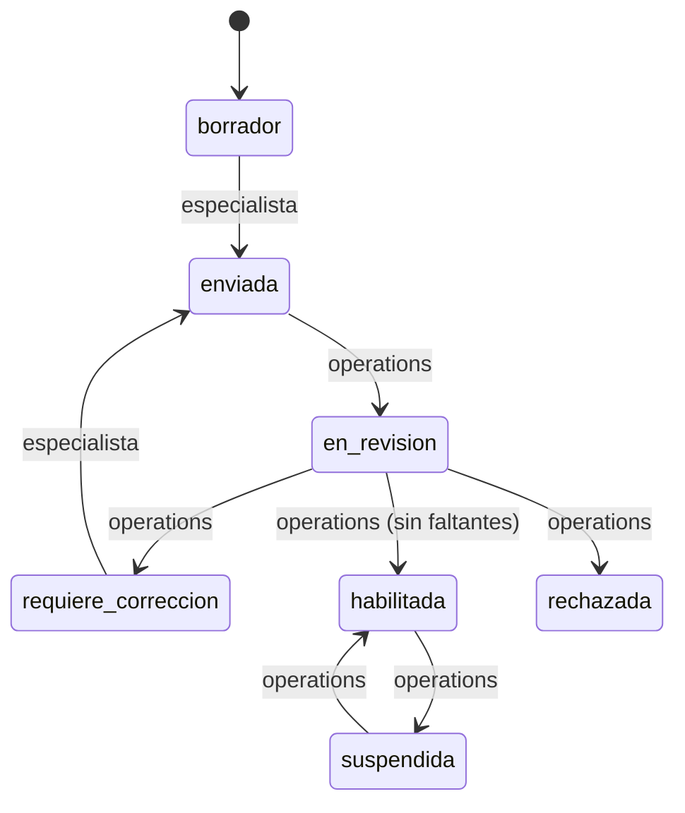
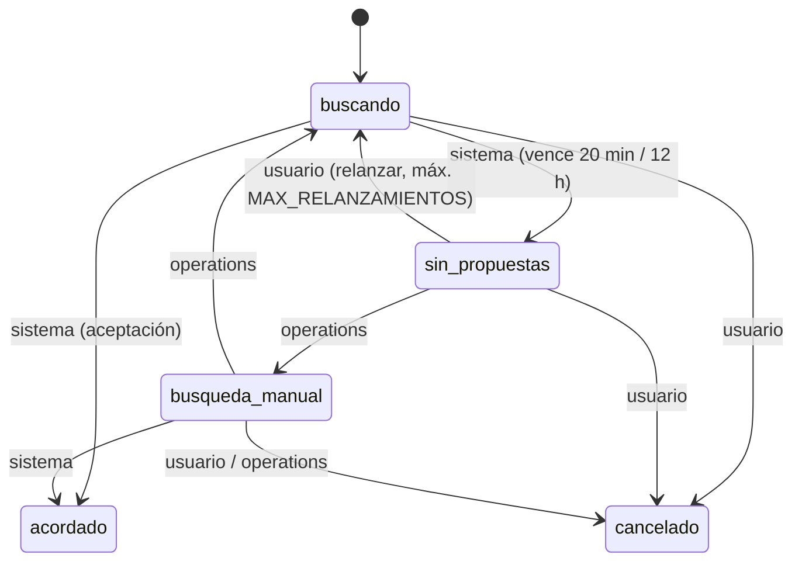
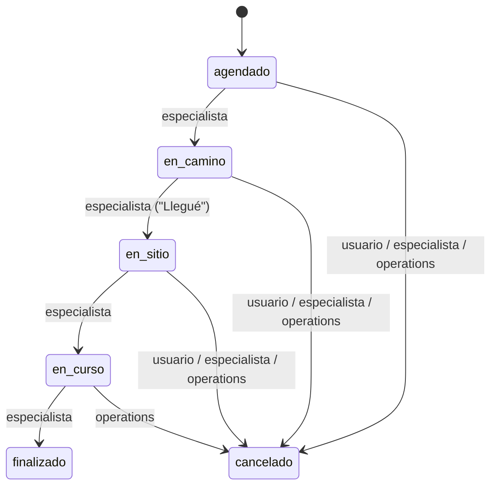

# Máquinas de estado (contrato v0.1.0)

Fuente ejecutable: `src/contracts/maquinas.ts` (probada en `src/contracts/contratos.test.ts`). El servidor valida cada
transición con estas tablas, registra actor y fecha (`job_events`, `audit_events`) y rechaza cualquier otra con
`409`. Actores: `especialista`, `usuario`, `operations` (portal), `sistema` (vencimientos, webhooks, transacciones).

## Alta del especialista

Habilitar exige `faltantesParaHabilitar() = []`: DNI, CUIT/CUIL y foto `verificado`, antecedentes `aprobada` y al
menos un rubro habilitado. El especialista no puede llegar a `habilitada` por ninguna transición.

## Documento (DNI · CUIT/CUIL · foto · matrícula)

`faltante → cargado` (especialista) → `en_revision` (operations) → `verificado | rechazado` (operations);
`rechazado | vencido → cargado` (especialista); `verificado → vencido` (sistema). **`cargado` nunca salta a
`verificado`.**

## Antecedentes (presencial)

`pendiente_cita → cita_coordinada → aprobada | no_aprobada | no_asistio` y `no_asistio → cita_coordinada`, todo por
Operations. No existe estado ni campo para archivos.

## Pedido (dueño: api-usuario)

Sin oferta no se inventan especialistas ni ETA. Urgente: las propuestas vencen a los 5 min y el pedido se relanza
mientras la ventana siga abierta (PROD-21 §9); quien lo dejó pasar no lo vuelve a recibir.

## Propuesta / contrapropuesta

`pendiente → aceptada | rechazada` (la **contraparte**), `pendiente → retirada` (el **autor**),
`pendiente → reemplazada | vencida` (sistema). `aceptada`, `rechazada`, `reemplazada`, `vencida` y `retirada` son
finales. `puedeResponder(p, actor, ahora)` exige pendiente, actor ≠ autor y `ahora < venceEn`.

Aceptar (servidor, una transacción): bloquea el pedido por versión, verifica que la propuesta siga pendiente y vigente,
la marca aceptada, crea el trabajo con el snapshot del acuerdo y pasa el pedido a `acordado`. Una segunda aceptación
concurrente recibe `409 propuesta_no_disponible`; el reintento con la misma `Idempotency-Key` devuelve el mismo
resultado.

## Trabajo

Cambiar monto, alcance u horario no es una transición: requiere una nueva propuesta aceptada por la otra parte, que
reemplaza el snapshot y queda en el historial. Confirmación del usuario al finalizar: PENDIENTE.

## Pago directo

`pendiente → reportado` (usuario o especialista) · `pendiente → verificado | fallido` (sistema: webhook validado) ·
`reportado → verificado` (operations o sistema) · `reportado → en_discrepancia` (cualquiera de las partes u
operations) · `en_discrepancia → verificado | fallido` (operations) · `fallido → pendiente` (usuario, reintento).
Quien reporta nunca verifica. Ningún estado implica que Handy recibió dinero.

## Soporte

`abierto → en_curso → esperando_respuesta ⇄ en_curso → resuelto → cerrado`; las partes pueden reabrir
`resuelto → en_curso`.

## Baja de cuenta

`solicitada → en_proceso → completada | completada_con_retencion`; `solicitada → cancelada` (la persona). El estado
se muestra tal cual: no hay éxito ficticio.
